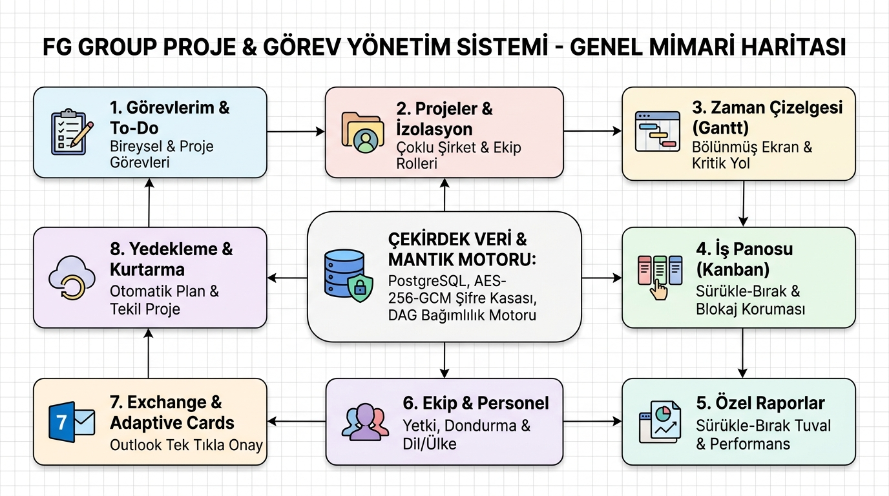
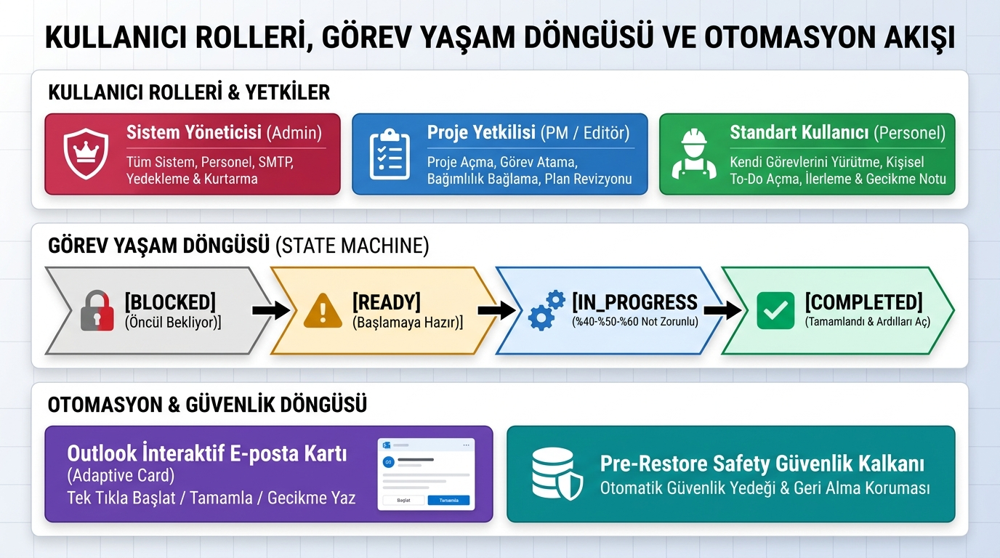
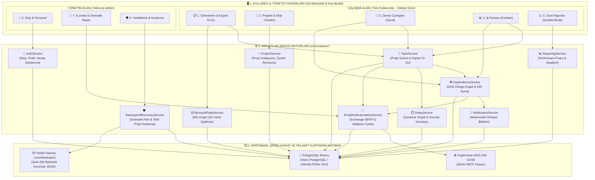
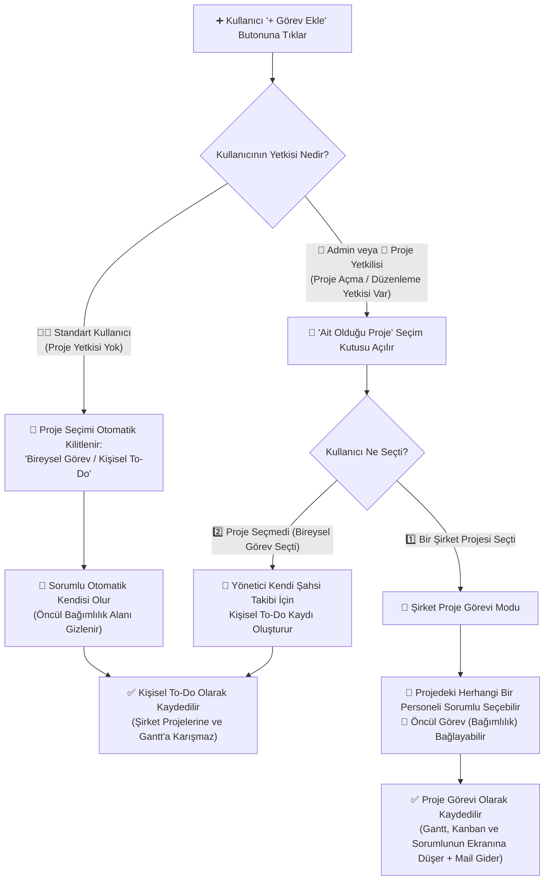
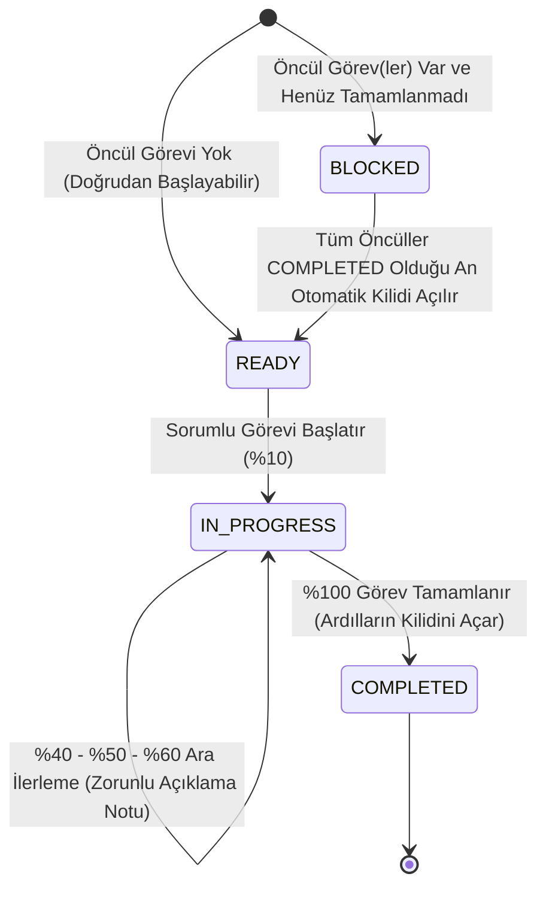
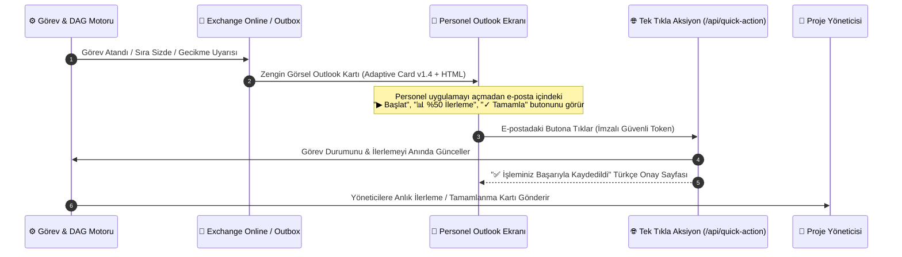
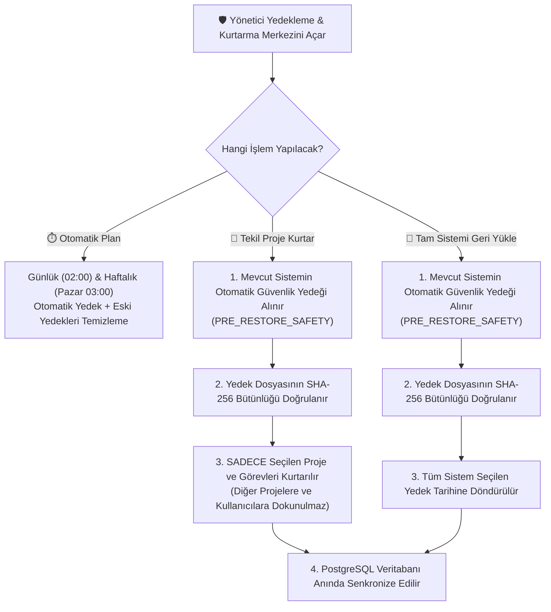
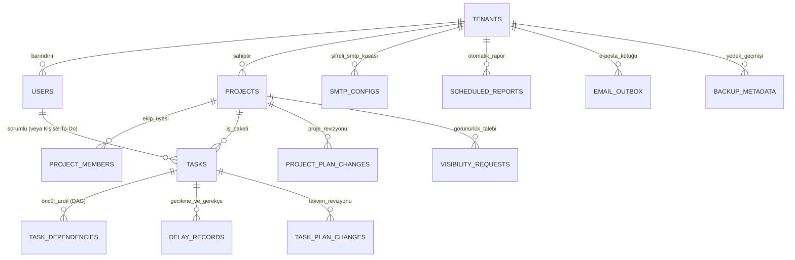

# 🗺️ FG Group Proje & Görev Yönetim Sistemi — Tam Görsel Mimari ve İş Akışı Şeması (`sema.md`)

Bu doküman, **FG Group Proje ve Görev Yönetim Sistemi**'nin tüm ekranlarını, modüllerini, arka plan motorlarını, kullanıcı yetki sınırlarını ve iş akışlarını tek bakışta görebilmeniz; mevcut yapıyı inceleyip eksik veya yeni taleplerinizi kolayca belirleyebilmeniz için hazırlanmıştır.

---

## 🖼️ 1. Genel Mimari ve İş Akışı İnfografik Posterleri

### 1.1. Sistem Mimarisi ve 8 Ana Modül Haritası


---

### 1.2. Kullanıcı Rolleri, Görev Yaşam Döngüsü ve Otomasyon Akışı


---

## 🏛️ 2. Üç Katmanlı Modüler Sistem Şeması

Sistem **birbirini bozmayan izole modüller** halinde 3 katmandan oluşur:
1. **Sunum Katmanı (`src/public/`):** Sol menüdeki 8 bağımsız ekran ve modallar.
2. **İş Mantığı Servis Katmanı (`src/modules/`):** Her biri kendi işinden sorumlu 10 bağımsız servis motoru.
3. **Veri, Kasa ve Yedekleme Katmanı (`src/database/` & `src/core/`):** PostgreSQL veritabanı, AES-256-GCM şifre kasası ve SHA-256 mühürlü yedek deposu.



---

## 🖥️ 3. Sol Menüdeki 8 Ekranın (Modülün) Detaylı Haritası

```
┌──────────────────────────────────────────────────────────────────────────────────────────┐
│  [FG] FG Group Yönetim Paneli        🔍 Görev, açıklama veya personel ara...   [+ Görev] │
├───────────────────────────┬──────────────────────────────────────────────────────────────┤
│  ÇALIŞMA ALANI            │                                                              │
│  📋 Görevlerim            │   SEÇİLEN MODÜLÜN ANA ÇALIŞMA EKRANI                         │
│  📁 Projeler              │   - Üst KPI Özet Kartları                                    │
│  📅 Zaman Çizelgesi(Gantt)│   - Filtre & Sekme Çubuğu                                    │
│  📊 İş Panosu (Kanban)    │   - İnteraktif Tablo / Gantt / Kanban / Tuval                │
│  📈 Özel Raporlar         │   - Sağdan Açılan Görev Detay Çekmecesi (Split Drawer)       │
│                           │                                                              │
│  YÖNETİM (Sadece Admin)   │                                                              │
│  👥 Ekip & Personel       │                                                              │
│  📧 E-posta & Rapor       │                                                              │
│  🛡️ Yedekleme & Kurtarma  │                                                              │
└───────────────────────────┴──────────────────────────────────────────────────────────────┘
```

### Modül 1: 📋 Görevlerim & Kişisel To-Do (`#view-my-tasks`)
* **Ne İşe Yarar?** Kullanıcının günlük çalışma masasıdır. Hem şirket projelerinden kendisine atanan görevleri hem de kendi takibi için oluşturduğu **📌 Kişisel To-Do (Bireysel Görev)** kayıtlarını gösterir.
* **Sekmeler:** `Tüm Görevlerim`, `🟢 Başlamaya Hazır`, `⚡ Devam Edenler`, `🔒 Öncül Bekleyenler (Blokeli)`, `⚠️ Gecikenler`, `📌 Kişisel To-Do`, `✅ Tamamlananlar`.
* **Özel Yetenekler:**
  - Görev satırına tıklandığında sağdan **OpenProject tarzı Detay Çekmecesi** açılır.
  - Microsoft To-Do / Outlook Görevleri ile çift yönlü senkronizasyon yapılabilir.

### Modül 2: 📁 Projeler & Ekip Rolleri (`#view-projects`)
* **Ne İşe Yarar?** Şirket projelerinin kartlar halinde izlendiği ve yönetildiği ekrandır.
* **Özel Yetenekler:**
  - Her proje kartında tamamlanma yüzdesi, görev sayıları, başlangıç/bitiş tarihleri ve proje ekibi görünür.
  - **`⚙️ Ekip, Plan & Görünürlük Yönetimi` Modalı:**
    - Projeye üye ekleme ve rol atama (`👑 Proje Yöneticisi`, `✏️ Düzenleyici / Editor`, `👁️ Tam Görüntüleyici / Viewer`).
    - Proje bitiş tarihini revize etme (**İlk Plan Tarihi** asla silinmez, revizyon geçmişi saklanır).
    - Standart personelden gelen **Görünürlük Taleplerini (KAB03)** onaylama veya reddetme.

### Modül 3: 📅 Zaman Çizelgesi — Gantt (`#view-timeline`)
* **Ne İşe Yarar?** Seçili projenin tüm iş paketlerini sol tarafta hiyerarşik tablo, sağ tarafta interaktif takvim çubukları olarak gösteren bölünmüş (split-screen) Gantt ekranıdır.
* **Özel Yetenekler:**
  - **4 Zoom Seviyesi:** `Günlük`, `Haftalık`, `Aylık`, `Yıllık` görünüm.
  - **Canlı SVG Bağımlılık Okları:** Hangi görevin hangisini beklediğini grafiksel oklarla çizer; geciken veya kilitli zincirleri kırmızı/turuncu vurgular.
  - **İzole Gösterim:** Personelin şahsi To-Do görevleri şirket Gantt takvimini kirletmez; burada yalnızca o projeye ait görevler yer alır.

### Modül 4: 📊 İş Panosu — Kanban (`#view-board`)
* **Ne İşe Yarar?** Görevleri 4 sütunda (`🔒 Öncül Bekleyen`, `🟢 Başlamaya Hazır`, `⚡ Devam Ediyor`, `✅ Tamamlandı`) sürükle-bırak ile yönetme ekranıdır.
* **Özel Yetenekler:**
  - **DAG Kilit Koruması:** Öncülü bitmemiş (`BLOCKED`) bir kartı kullanıcı sürükleyip `Devam Ediyor` sütununa bırakmak isterse sistem bunu otomatik engeller ve hangi öncül görevin beklendiğini bildirir.

### Modül 5: 📈 Özel Rapor Oluşturucu (`#view-report-builder`)
* **Ne İşe Yarar?** Sol paletten bileşenleri sürükleyip sağdaki tuvale bırakarak özel yönetim raporları hazırlama ekranıdır.
* **9 Sürükle-Bırak Bileşeni:**
  1. 📊 Üst Özet KPI Kartları
  2. 🏆 Personel Performans & Puan Tablosu (`100 * (0.70*Z + 0.30*T)`)
  3. 🍩 Görev Durum Dağılım Grafiği
  4. 📁 Proje Bazlı İlerleme Karşılaştırması
  5. ⚠️ Gecikme & Kök Neden Analiz Tablosu
  6. 🕸️ Kritik Bağımlılık & Darboğaz Listesi
  7. 👥 Departman & Ülke İş Yükü Dağılımı
  8. 📅 Plan Revizyon Geçmişi (İlk Plan vs. Güncel Plan)
  9. 📝 Yönetici Değerlendirme Notu Alanı
* **Çıktılar:** Şablon olarak kaydetme, PDF/Yazıcı çıktısı alma, Excel/CSV dışa aktarma.

### Modül 6: 👥 Ekip & Personel Yönetimi (`#view-team` — Admin)
* **Ne İşe Yarar?** Şirket çalışanlarının hesaplarını, ülkelerini/dillerini ve sistem yetkilerini yönetme ekranıdır.
* **Özel Yetenekler:**
  - Yeni personel açıldığında sistem otomatik güvenli şifre üretir ve çalışana **🎉 Hoş Geldiniz & Erişim Bilgileri Outlook Kartı** gönderir.
  - Tek tıkla **`Proje Yetkisi` (`can_create_project`)** ve **`Rapor Yetkisi` (`can_build_reports`)** açıp kapatma.
  - **Hesap Dondurma (`is_active: false`):** İşten ayrılan personelin geçmiş görev kayıtları bozulmadan sisteme girişi ve yeni görevlere atanması anında engellenir (Kendi hesabını veya son admini kilitleme koruması vardır).

### Modül 7: 📧 E-posta & Otomatik Rapor (`#view-email-automation` — Admin)
* **Ne İşe Yarar?** Exchange Online Plan 1 SMTP ayarlarının, zamanlanmış otomatik raporların ve Outlook Adaptive Card simülatörünün yönetim merkezidir.
* **Özel Yetenekler:**
  - **2 Gönderim Modu:** Standart Şifreli SMTP (`smtp.office365.com:587`) veya Şifresiz Kurumsal Direct Send (` port 25 MX`).
  - **Zamanlanmış Raporlar:** Günlük/Haftalık periyotlarla seçilen saatte yöneticilere otomatik proje özet raporu gönderir.
  - **Canlı Outbox Simülatörü:** Gönderilen tüm e-postaların içindeki interaktif butonları (`▶ Görevi Başlat`, `📊 %50 İlerleme`, `✓ Tamamla`) ekran üzerinden canlı test etme imkanı.

### Modül 8: 🛡️ Yedekleme & Felaket Kurtarma (`#view-backup-recovery` — Admin)
* **Ne İşe Yarar?** Sistemin veya tek bir projenin başına bir kaza geldiğinde veri kaybı olmadan kurtarma yapan güvenlik merkezidir.
* **Özel Yetenekler:**
  - **Otomatik Zamanlama:** Günlük (örn. 02:00, 14 gün saklama) ve Haftalık (örn. Pazar 03:00, 8 hafta saklama) otomatik yedekleme.
  - **🎯 Tekil Proje Kurtarma:** Diğer hiçbir projeye dokunmadan, yedek içinden sadece seçilen projeyi ve görevlerini geri yükleme.
  - **🔄 Tam Sistem Geri Yükleme:** Tüm sistemi seçilen tarihe döndürme.
  - **🛡️ Otomatik Güvenlik Yedeği (`PRE_RESTORE_SAFETY`):** Her geri yükleme işleminden hemen önce mevcut durumun otomatik yedeğini alır; yanlış bir yedeğe dönülse bile sıfır veri kaybıyla geri alınır.

---

## 👥 4. Kullanıcı Rolleri ve "+ Görev Ekle" Karar Şeması

Kullanıcı sağ üstteki **`+ Görev Ekle`** butonuna tıkladığında yetkisine göre çalışan karar ağacı:



---

## 🔗 5. Görev Yaşam Döngüsü ve DAG Bağımlılık Kuralları



### Kritik İş Kuralları (Şartname v0.3)
1. **Döngüsel Bağımlılık Engeli (KAB04):** `Görev A ➔ Görev B ➔ Görev C` bağlıyken `C ➔ A` bağlanmak istenirse sistem **DFS (Derinlik Öncelikli Arama)** ile döngüyü yakalar ve işlemi reddeder.
2. **Çoklu Öncül Kuralı (KAB05):** `Görev C` hem `A` hem `B` görevini bekliyorsa, yalnızca `A` bittiğinde `C` açılmaz; `B` de tamamlandığı anda `C` otomatik olarak `READY` durumuna geçer.
3. **%40 - %50 - %60 Zorunlu Açıklama Kuralı:** Bir görevin ilerleme yüzdesi %40, %50 veya %60 seviyesine getirildiğinde açıklama girilmesi zorunludur; girilen not anında proje yöneticilerine e-posta kartı olarak iletilir.
4. **Blokeli Gecikme Muafiyeti (KAB06 & RAP05):** Öncül görev geciktiği için `BLOCKED` kalan bir görevin tarihi geçerse, sistem bunu çalışanın kusuru saymaz; otomatik sistem gerekçesi oluşturur ve çalışanın performans puanını düşürmez.

---

## 🏆 6. Adil Performans Puanı Hesaplama Matematiği

Raporlama motoru (`ReportingService`), her çalışanın performansını şu matematiksel formülle hesaplar:

$$\text{Performans Puanı} = 100 \times (0.70 \times Z + 0.30 \times T)$$

* **$Z$ (Zamanında Tamamlama Oranı - %70 Ağırlık):** Zamanında biten görevlerin, çalışanın sorumlu olduğu (öncül blokajından muaf tutulmuş) toplam görevlere oranı.
* **$T$ (Genel Tamamlama Oranı - %30 Ağırlık):** Tamamlanan tüm görevlerin atanan toplam görevlere oranı.

---

## 📧 7. Exchange Online & Outlook İnteraktif Kart Döngüsü



---

## 🛡️ 8. Felaket Kurtarma & Tekil Proje Kurtarma Şeması



---

## 🗄️ 9. Veritabanı Tablo Yapısı (PostgreSQL 16 Tablo) ve Kod Dizini



### 📂 Proje Klasör Haritası
```text
y:\gorevler1\
├── sema.md                                  # 🗺️ (Bu Dosya) Tam Görsel Mimari ve İş Akışı Şeması
├── takip.md                                 # 📋 Günlük Yapılan İşler ve 25 Fazın Detaylı Kayıt Defteri
├── docs/
│   ├── fg_group_sistem_mimarisi_infografik.jpg
│   └── fg_group_is_akisi_ve_yetki_semasi.jpg
├── src/
│   ├── core/
│   │   ├── types.ts                         # Tüm veri modelleri ve arayüz tanımları
│   │   └── crypto-vault.ts                  # AES-256-GCM şifreleme kasası
│   ├── database/
│   │   ├── db.ts                            # Bellek + Disk + Yedekleme/Kurtarma veri katmanı
│   │   ├── postgres.ts                      # PostgreSQL / PGlite çift yönlü senkronizasyon motoru
│   │   ├── schema.sql                       # PostgreSQL 16 tabloluk ilişkisel DDL şeması
│   │   └── seed.ts                          # Varsayılan demo/başlangıç verisi
│   ├── modules/
│   │   ├── auth/auth.service.ts             # Giriş, şifre, profil resmi, personel dondurma
│   │   ├── project/project.service.ts       # Proje izolasyonu, üyelik, revizyon, görünürlük
│   │   ├── task/task.service.ts             # Proje görevi, kişisel To-Do, %40-%50-%60 ilerleme
│   │   ├── dependency/dependency.service.ts # DAG döngü kontrolü ve otomatik kilit açma
│   │   ├── delay/delay.service.ts           # Gecikme kaydı ve zorunlu açıklama takibi
│   │   ├── reporting/reporting.service.ts   # Performans puanı ve raporlama hesaplamaları
│   │   ├── notification/notification.service.ts # Mükerrerlik önleyici bildirim servisi
│   │   ├── microsoft_todo/microsoft_todo.service.ts # Microsoft To-Do senkronizasyonu
│   │   ├── email/email.service.ts           # Exchange SMTP, Adaptive Cards v1.4 ve zamanlayıcı
│   │   └── backup/backup.service.ts         # Otomatik yedekleme ve tekil proje / tam kurtarma
│   ├── server/
│   │   └── index.ts                         # Express REST API sunucusu ve güvenlik katmanı
│   └── public/
│       ├── index.html                       # 8 modüllü tek sayfa uygulama arayüzü
│       ├── styles.css                       # Kurumsal açık/koyu tema tasarım sistemi
│       └── app.js                           # İstemci tarafı durum yönetimi ve modül mantığı
└── tests/
    └── acceptance.test.ts                   # 29 adet uçtan uca kabul ve güvenlik testi
```

---

## 💡 10. İnceleme Sonrası Yeni Talep / Eksik Belirleme Rehberi

Yukarıdaki şemaları inceledikten sonra yeni taleplerinizi belirlerken aşağıdaki kontrol listesini referans alabilirsiniz:

- [ ] **1. Görevlere Dosya & Görsel Yükleme (Attachments):** Görev içine kanıt fotoğrafı, PDF, Excel veya numune görseli yükleme.
- [ ] **2. Alt Görevler / Kontrol Listesi (Sub-tasks / Checklist):** Bir görevin içine maddeler halinde alt adımlar ekleme ve tik atıldıkça ilerleme yüzdesinin otomatik artması.
- [ ] **3. Yönetici Görev Onay / Revize Akışı:** Personel görevi "Tamamladım" dediğinde doğrudan kapanması yerine, proje yöneticisinin "Onayla" veya "Revizeye Gönder" demesi.
- [ ] **4. Hazır Proje Şablonları (Project Templates):** Sık tekrarlanan projeleri tüm görev ve bağımlılıklarıyla şablon olarak kaydedip tek tıkla yeni proje açma.
- [ ] **5. Efor (Adam-Saat) & Maliyet Takibi:** Görev bazında harcanan çalışma saati girişi ve bütçe kontrolü.
- [ ] **6. Denetim Kütüğü (Audit Log Ekranı):** Yönetici panelinde kimin hangi gün hangi kaydı değiştirdiğini gösteren izleme tablosu.
- [ ] **7. Mevcut 8 Modülde Revizyon:** Yukarıdaki şemalarda gördüğünüz mevcut ekranlardan herhangi birinde değiştirmek veya sadeleştirmek istediğiniz kurallar.

