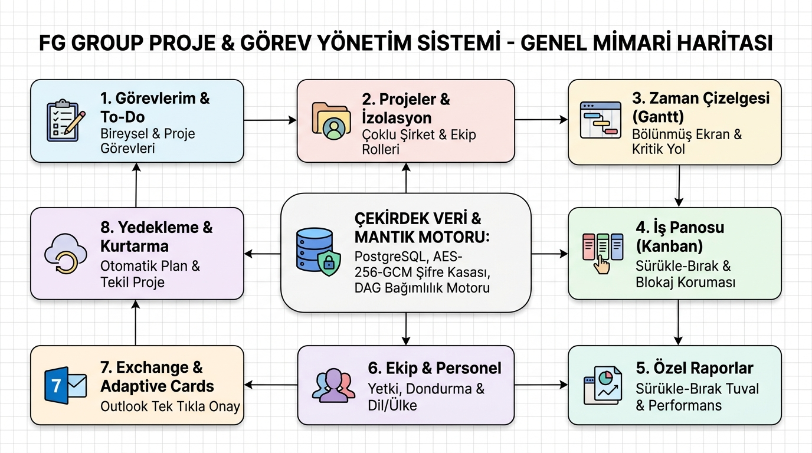
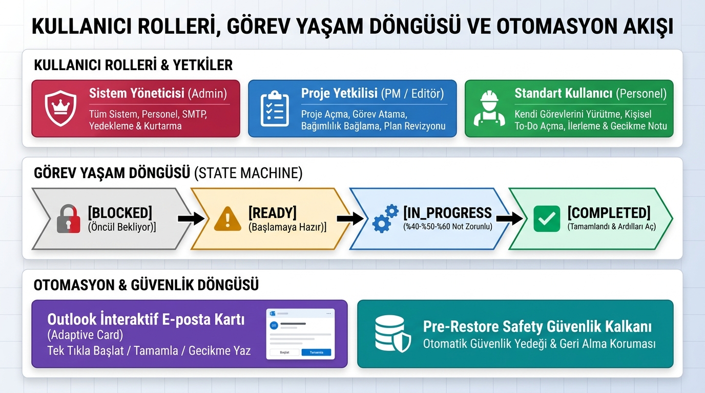
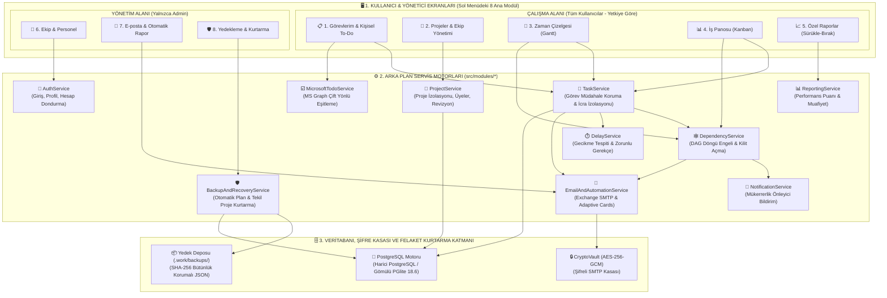
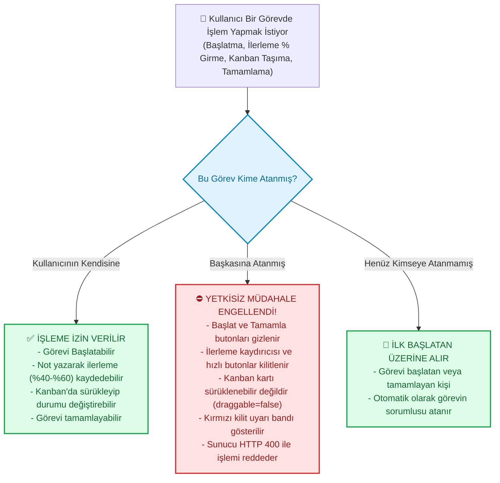

# 🗺️ FG Group Proje & Görev Yönetim Sistemi — Tam Görsel Mimari, İş Akışı ve Yetki Şeması (`tam_sema.md`)

Bu doküman, **FG Group Proje ve Görev Yönetim Sistemi**'nin tüm ekranlarını, modüllerini, arka plan motorlarını, kullanıcı yetki sınırlarını ve iş akışlarını tek bakışta görebilmeniz; mevcut yapıyı inceleyip eksik veya yeni taleplerinizi kolayca belirleyebilmeniz için hazırlanmıştır.

---

## 🖼️ 1. Genel Mimari ve İş Akışı İnfografik Posterleri

### 1.1. Sistem Mimarisi ve 8 Ana Modül Haritası


---

### 1.2. Kullanıcı Rolleri, Görev Yaşam Döngüsü ve Yetki İzolasyonu Akışı


---

## 🏛️ 2. Üç Katmanlı Modüler Sistem Şeması

Sistem **birbirini bozmayan bağımsız modüller** halinde 3 katmandan oluşur:
1. **Sunum Katmanı (`src/public/`):** Sol menüdeki 8 bağımsız ekran ve modallar.
2. **İş Mantığı Servis Katmanı (`src/modules/`):** Her biri kendi işinden sorumlu 10 bağımsız servis motoru.
3. **Veri, Kasa ve Yedekleme Katmanı (`src/database/` & `src/core/`):** PostgreSQL veritabanı, AES-256-GCM şifre kasası ve SHA-256 mühürlü yedek deposu.



---

## 🔒 3. Görev Müdahale Koruması ve İcra İzolasyonu (Kim Ne Yapabilir?)

Hiçbir kullanıcı bir başkasının görevine müdahale edemez. Sorumluluk ve yetki sınırları katı bir şekilde izole edilmiştir:



---

## 👥 4. Kullanıcı Rolleri Matrisi

| Yetki & İşlem | Sistem Yöneticisi (Admin) | Proje Yöneticisi (PM) | Proje Editörü | Standart Personel (Görev Sorumlusu) |
| :--- | :---: | :---: | :---: | :---: |
| **Sistem Ayarları & SMTP Kasası** | ✅ Tam Yetkili | ❌ Göremez | ❌ Göremez | ❌ Göremez |
| **Yedek Alma & Geri Yükleme** | ✅ Tam Yetkili | ❌ Göremez | ❌ Göremez | ❌ Göremez |
| **Personel Ekleme / Dondurma** | ✅ Tam Yetkili | ❌ Göremez | ❌ Göremez | ❌ Göremez |
| **Yeni Proje Açma** | ✅ Evet | ✅ Evet (İzinli) | ❌ Hayır | ❌ Hayır |
| **Proje Plan Revizyonu** | ✅ Evet | ✅ Evet | ❌ Hayır | ❌ Hayır |
| **Görev Oluşturma / Atama** | ✅ Evet | ✅ Evet | ✅ Evet | ❌ Hayır |
| **Başkasına Atanmış Görevi Başlatma** | ⛔ Engellendi | ⛔ Engellendi | ⛔ Engellendi | ⛔ Engellendi |
| **Başkasına Atanmış Görevi Tamamlama** | ⛔ Engellendi | ⛔ Engellendi | ⛔ Engellendi | ⛔ Engellendi |
| **Kendi Görevini Başlatma/İlerletme** | ✅ Evet | ✅ Evet | ✅ Evet | ✅ Evet |
| **Kendi Bireysel To-Do'sunu Açma** | ✅ Evet | ✅ Evet | ✅ Evet | ✅ Evet |
| **Gantt & Kanban İnceleme** | ✅ Tüm Şirket | ✅ Kendi Projeleri | ✅ Kendi Projeleri | 👁️ Kendi ve Bağlı Görevleri |

---

## 🗂️ 5. Proje Dizin Yapısı ve Modül Sorumlulukları

```text
y:\gorevler1\
├── docs\                                      # Mimari infografikler ve kılavuzlar
│   ├── fg_group_sistem_mimarisi_infografik.jpg # Genel mimari infografiği
│   └── fg_group_is_akisi_ve_yetki_semasi.jpg   # Görev akışı ve yetki infografiği
├── src\
│   ├── core\                                  # Tip tanımları ve çekirdek yapılar
│   │   ├── types.ts                           # Tenant, Project, Task, User, WorkStatus
│   │   └── crypto_vault.ts                    # AES-256-GCM kurumsal şifre kasası
│   ├── database\                              # Veritabanı ve başlangıç verileri
│   │   ├── db.ts                              # PostgreSQL adaptörü & PGlite motoru
│   │   └── seed.ts                            # FG Group 5 kişilik gerçekçi demo verileri
│   ├── modules\                               # Bağımsız iş mantığı servisleri
│   │   ├── auth\                              # Giriş, profil, avatar ve hesap dondurma
│   │   ├── project\                           # Proje izolasyonu ve üyelik yetkileri
│   │   ├── task\                              # Görev oluşturma, müdahale engeli ve plan
│   │   ├── dependency\                        # DAG bağımlılık kontrolü ve döngü engeli
│   │   ├── delay\                             # Gecikme tespiti ve zorunlu gerekçe kaydı
│   │   ├── notification\                      # Mükerrerliği önleyen bildirim kuyruğu
│   │   ├── reporting\                         # Performans formülü ve özel rapor üretici
│   │   ├── microsoft_todo\                    # Microsoft Graph çift yönlü eşitleme
│   │   ├── email_automation\                  # Exchange SMTP ve Adaptive Cards
│   │   └── backup\                            # Otomatik yedekleme ve tekil proje kurtarma
│   ├── public\                                # Frontend (SPA)
│   │   ├── index.html                         # 8 modüllü arayüz iskeleti ve çekmeceler
│   │   ├── app.js                             # Durum yönetimi, Kanban, Gantt, çekmece
│   │   └── styles.css                         # Modern tema (Aydınlık/Karanlık)
│   └── server\
│       └── index.ts                           # Express REST API, CORS ve güvenlik duvarı
├── tests\
│   └── acceptance.test.ts                     # 30 adet uçtan uca kabul ve şartname testi
├── sema.md                                    # Görsel mimari rehberi
├── tam_sema.md                                # Eksiksiz mimari, yetki ve iş akışı şeması
└── takip.md                                   # Geliştirme günlüğü ve tamamlanan isterler
```

